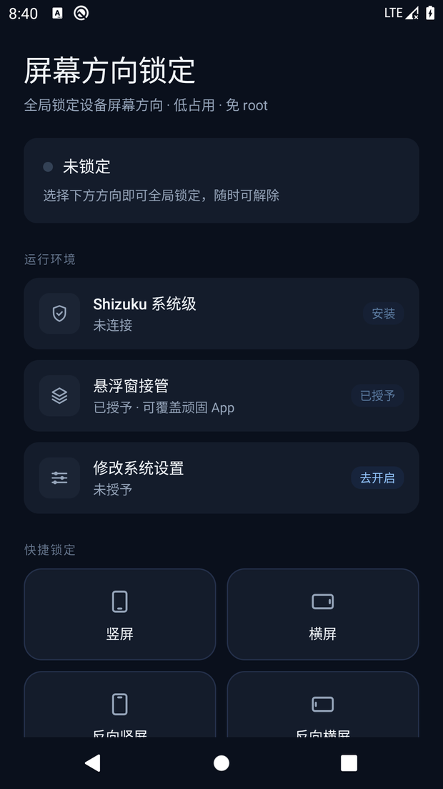
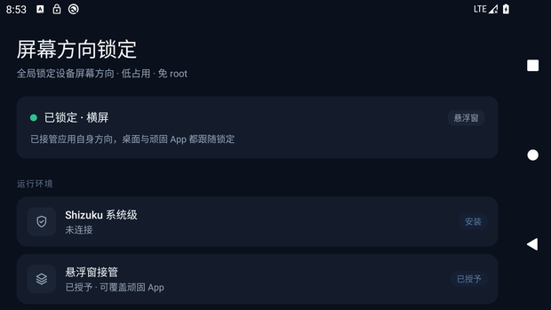
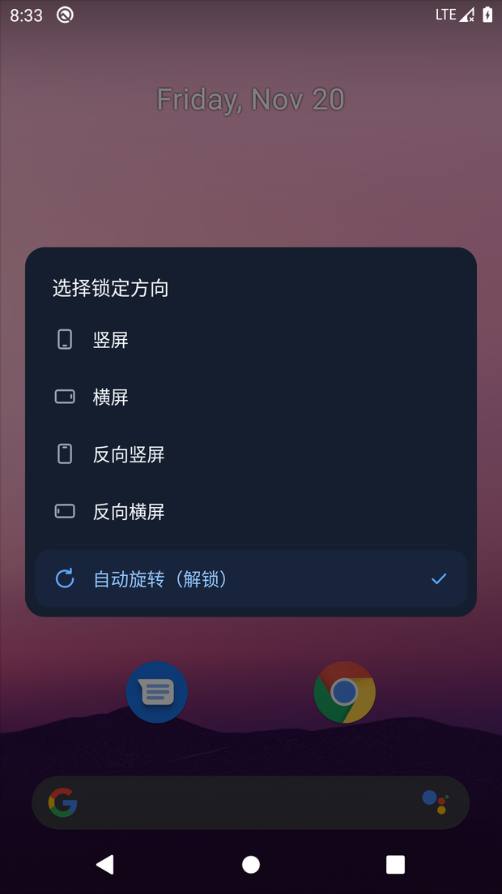
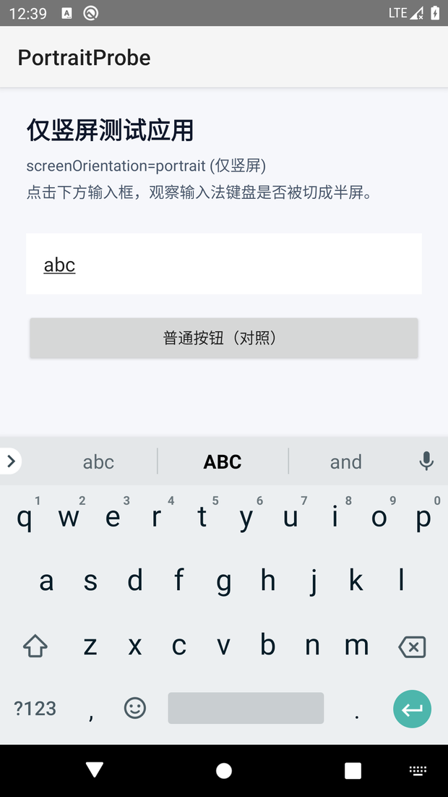
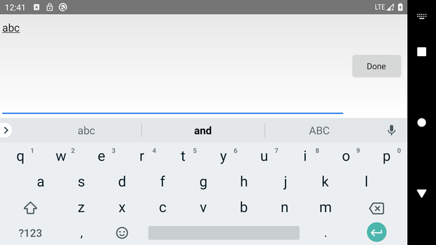
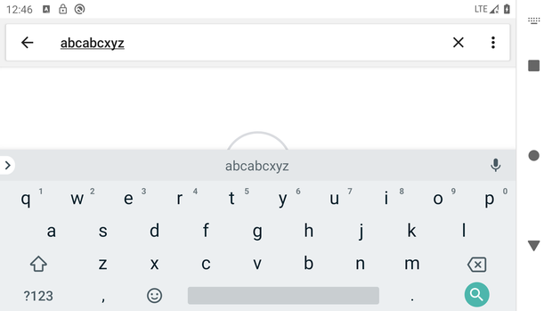

# Orientation Locker

> Android 10 全局屏幕方向锁定 App —— 低占用、免 root（Shizuku / 悬浮窗双路径）· APK 76 KB

一个在 Android 10 上可运行的**全局屏幕方向锁定**工具。锁定的核心是"夺走 App 自己决定方向的权力"：Shizuku 模式下调用系统原生 `IWindowManager.freezeRotation()` + `setFixedToUserRotation()`；没有 Shizuku 时，用一个 1×1 透明悬浮窗冒充方向请求，同样能压过写死 `screenOrientation` 的 App。

## 三条生效路径（自动按代价从低到高选择）

| 路径 | 需要的权限 | 能覆盖写死方向的 App | 常驻组件 | 内存 |
|---|---|---|---|---|
| **① Shizuku** | Shizuku（电脑 ADB 或 root 激活） | ✅ | **无** | 进程可被系统回收 |
| **② 悬浮窗接管** | 「显示在其他应用上层」 | ✅ | 一个前台服务 + 1×1 窗口 | 约 25 MB |
| **③ 系统设置** | 「修改系统设置」 | ❌ | 无 | 最低 |

能用 ① 就绝不启用 ②——有 Shizuku 的用户不为降级方案付任何常驻内存。

## 特性

- 全局锁定竖屏 / 横屏 / 反向竖屏 / 反向横屏（反向 90°/270° 精确区分）
- 快捷设置磁贴点击弹出方向菜单，一键切换
- 覆盖强行指定自身方向的顽固 App（① ② 均可；见「已知限制」的 letterbox 说明）
- 无 Shizuku 时自动降级：有悬浮窗权限走 ②，只有写设置权限走 ③，界面如实显示当前走了哪条、能否覆盖顽固 App
- 解锁时精确恢复用户锁定前的自动旋转开关状态
- 事件驱动、零轮询、零 WakeLock、无网络、无统计 SDK
- 悬浮窗路径的保活通知是 `IMPORTANCE_MIN` + 静音 + 锁屏隐藏，几乎不可见
- **原生 UI，零 androidx 依赖**：无 AppCompat 初始化，冷启动更快，APK 仅 57 KB
- 深色模式自适应；状态采集全部在后台线程，打开界面不做任何跨进程调用
- **界面**：状态卡 + 三条运行环境 + 2×2 方向网格；按压有回弹，入场分层淡入，锁定时状态点呼吸
- **方向面板**：圆角浮层，缩放淡入；选项逐行浮现，选中勾平滑切换

## 界面

<p>
  
  
  
</p>

主界面分三层：**状态卡**（是否锁定、走哪条路径）→ **运行环境**（三条权限各自就绪与否）→ **2×2 方向网格**。点任意方向立即生效，状态卡同步变绿并标注当前路径。方向面板（右图）由磁贴或通知唤起，圆角浮层、选项逐行浮现、当前项打勾。

动效全部原生实现（`ViewPropertyAnimator` / `ObjectAnimator`），无第三方库；仅在前台运行，`onPause` 即停，不额外耗电。

## 输入法对照（横屏锁定下键盘正常）

针对「输入法卡掉一半」的反馈，用严格 `screenOrientation="portrait"` 的测试 App（`docs/portrait-probe.apk`）做了三组对照，键盘均正常撑满屏宽：

<p>
  
  
  
</p>

左：竖屏基线；中：横屏锁定 + 仅竖屏 App；右：横屏锁定 + 设置 App 搜索框。横屏输入本就是「上半屏提取文字 + 下半屏键盘」的全屏模式，详见 `TEST_REPORT.md` 第十二章。

## 技术栈

Kotlin · AGP 8.6 · Gradle 8.9 · JDK 21 · Shizuku API 13.1.5 · 反射调用隐藏 API · SharedPreferences

| 项 | 值 |
|----|----|
| minSdk | 24 (Android 7.0) |
| targetSdk / compileSdk | 34 |
| 测试目标真机 | Android 10 (API 29) |
| 包名 | `com.orientationlocker` |

## 文档

- [项目规划（v3 决策冻结版）](PLAN.md) —— 需求锁定卡、技术选型权衡、架构、Wave 计划、验证方案、风险
- [技术栈确认清单](TECH_STACK.md) —— 语言/构建/SDK/依赖版本锁定、隐藏 API 调用方式、组件架构、测试栈
- [云端测试报告](TEST_REPORT.md) —— Android 10 模拟器实测结果、修复的缺陷、内存实测、未闭环项

## 测试

| 层级 | 用例数 | 结果 |
|---|---|---|
| JVM 单元测试（JUnit + Robolectric） | 31 | ✅ |
| 仪器测试（Android 10 运行时） | 7 | ✅ |

```bash
./gradlew :app:testDebugUnitTest          # 单元测试
./gradlew :app:connectedDebugAndroidTest  # 仪器测试（需连接设备/模拟器）
```

关键实测（Android 10 模拟器）：

| 场景 | 结果 |
|---|---|
| 仅给悬浮窗权限、无 Shizuku、无写设置权限，锁横屏 | `ROTATION_90` |
| 紧接着进入 `android:screenOrientation="portrait"` 的页面 | **仍 `ROTATION_90`** |
| 锁反向横屏 | `ROTATION_270`（与正向精确区分） |
| 解锁 | 回 `ROTATION_0`，窗口与服务计数归零 |
| 强制 `kill -9` 进程 | 系统重启服务，窗口重建，方向保持 `ROTATION_90` |
| 此时系统设置 | `user_rotation=0`、`accelerometer=1` → 方向**完全由窗口撑住**，不依赖写设置权限 |

内存（release 包，仅挂窗口与薄服务时）：**24.9 MB PSS**；打开过主界面后 39–41 MB（Activity 自身的开销，与锁定无关）。窗口本体相对解锁状态只多约 2.5 MB。

## 已知限制

1. Android 10 激活 Shizuku 需 **ADB 电脑授权或 root**（无线调试激活是 Android 11+ 特性）。
2. 部分国产 ROM 可能重置 `freezeRotation` 状态，需真机验证 + 开机兜底。
3. 系统设置持久，卸载/解锁前务必 `thawRotation` 并恢复用户原值。
4. **letterbox（黑边）**：锁定后屏幕方向不再被 App 抢走，但个别在 manifest 里写死 `android:screenOrientation` 的 App 仍可能按自己声明的方向排版，显示成屏幕中央的竖条/横条并留黑边。这是 WMS 的兼容模式，非 root 无法让这类 App 的内容铺满；同类 App（如 Rotation）同样存在。
   - **输入法键盘实测正常**：用专门的「仅竖屏」测试 App（`screenOrientation="portrait"`，见 `portrait-probe.apk`）在横屏锁定下弹键盘，键盘撑满屏宽、处于全屏输入模式，与竖屏基线一致；同一状态下「设置」App 搜索框也正常。横屏输入本身就是"上半屏提取文字 + 下半屏键盘"的全屏模式，不是"卡掉一半"。若个别机型/第三方输入法仍有异常，多为 ROM 或输入法自身行为，临时可磁贴 →「自动旋转」解锁后再输入。
   - **Android 11+ 且启用 Shizuku** 时本 App 会调用 `setIgnoreOrientationRequest(true)` 让系统忽略 App 的方向声明，可进一步消除黑边；Android 10 的 `setFixedToUserRotation` 不具备这个能力。
5. **悬浮窗路径依赖进程存活**：窗口随进程消失，所以锁定期间必须有一个前台服务保活（这就是它比 Shizuku 路径多占约 25 MB 的原因）。进程被强杀后系统会按 `START_STICKY` 重启并重建窗口（实测有效），但若系统把应用判为 idle 而拒绝重启服务，锁定会失效——重新打开 App 即自愈。Shizuku 路径无此问题，因为状态由 system_server 持有。

## 状态

**v1.2.0 已构建并验证**（versionCode 6）：

| Wave | 内容 | 状态 |
|------|------|------|
| 1 | Gradle 工程骨架、Shizuku 依赖与授权引导 | ✅ |
| 2 | 核心锁定（反射 `freezeRotation`）+ 磁贴方向菜单 | ✅ |
| 3 | WRITE_SETTINGS 降级 + 开机兜底 + 解锁精确恢复 | ✅ |
| 4 | 构建产物：已签名 Release APK | ✅ |
| 5 | 方向覆盖：`setFixedToUserRotation` / `setIgnoreOrientationRequest`，修复"进某些 App 变回竖屏" | ✅ v1.0.2 |
| 6 | 悬浮窗接管路径（免 Shizuku 覆盖顽固 App）+ `HiddenApiBypass` 懒加载 | ✅ v1.0.3 |
| 7 | 去 androidx + R8 压缩（2.5 MB → 57 KB）、主线程去阻塞、深色模式 | ✅ v1.1.0 |
| 8 | 界面与动效重构：卡片化布局、方向网格、按压/入场/呼吸动画、面板浮层动画 | ✅ v1.2.0 |

源码结构见下方；构建方式见 [BUILD.md](BUILD.md)。

```
app/src/main/java/com/orientationlocker/
├── core/       Rotations / RotationController / FallbackController
│               OverlayController / LockStateRepository / LockManager
├── service/    OverlayLockService（悬浮窗路径的保活壳，不画 UI）
├── shizuku/    ShizukuHelper
├── tile/       OrientationTileService
├── boot/       BootRestoreReceiver
└── ui/         MainActivity / OrientationPickerActivity
```

> 悬浮球（原 Wave 4）按决策移出首版，留待后续迭代。
